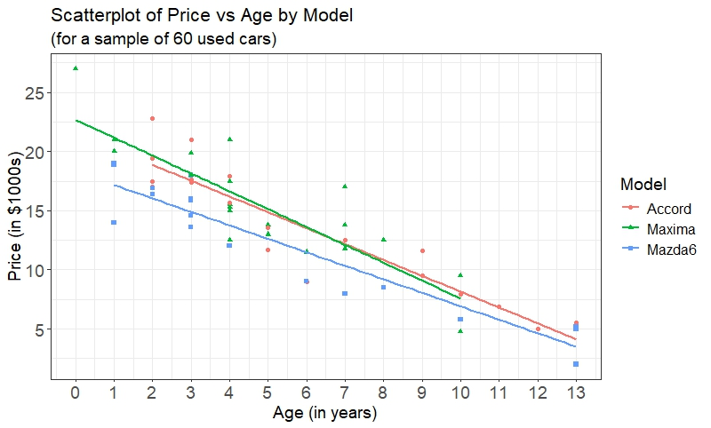

```{r setup, include=FALSE}
knitr::opts_chunk$set(echo = TRUE)
```


\newpage

## Instructions

Complete the Lab Exercises and In Your Own Words sections below. All lab assignments are out of 24 points with the following breakdown:

- Lab Exercises (14 points): The seven exercises will be graded for correctness and are worth 2 points each. 

- In Your Own Words (10 points): Two of these four questions will be graded for correctness and are worth 4 points each. The remaining two questions will be graded for completion and are worth 1 point each. The instructional team will decide which of the two questions will be evaluated for correctness after the assignment closes.

Upon completion, follow the submission instructions at the bottom of this document. We encourage you to work on this assignment with a partner, but only active lab approach students (enrolled in the same lab section) may submit their work in pairs.


***


## Background

In an attempt to model the price of used cars, data were collected for a random sample of 60 used cars consisting of three different car models (Honda Accord, Nissan Maxima, and Mazda 6). The data were collected from cars.com and include the following variables:

1. Model: the model of the car (Accord, Maxima, or Mazda6)
2. Age: the age of the car (in years)
3. Price: the price of the car (in thousands of dollars)
4. Mileage: the mileage of the car (in thousands of miles)

**Analysis Goal:** First, determine whether age or mileage is a better linear predictor of selling price. Then, explore the linear relationship of the stronger predictor with price.


Use the following code chunk to read in the data set. 

```{r read_data}
load("usedcars.Rda")
```

And load in any necessary packages.

```{r load_packages}
library(ggplot2)
```


***


## Lab Exercises (14 points)

After reading the background above, complete the following lab exercises. Remember, these exercises are worth 2 points each and are graded for correctness.

\newpage

### Exercise 1

First, run the code chunk below to preview the data. After reading the background and analysis goal above, identify the response variable, its variable type, and its units.

```{r preview_data}
head(usedcars)
```

**Response Variable Name:** Replace this text with the variable name 

**Response Variable Type:** Categorical / Quantitative  

**Response Variable Units:** Replace this text with the units of the variable


\newpage

### Exercise 2

Using `ggplot()`, create a scatterplot that visualizes the influence of *age* on selling price. Be sure to include an informative title and informative axis labels. 

```{r exercise2}
# Replace this comment with your code

```

In 1 - 2 sentences, comment on the relationship observed in the scatterplot. Your answer should comment on linearity, direction, strength, and potential outliers. 

**Answer:** Replace this text with your answer


\newpage

### Exercise 3

Using `ggplot()`, create a scatterplot that visualizes the influence of *mileage* on selling price. Be sure to include an informative title and informative axis labels. 

```{r exercise3}
# Replace this comment with your code

```

In 1 - 2 sentences, comment on the relationship observed in the scatterplot. Your answer should comment on linearity, direction, strength, and potential outliers. 

**Answer:** Replace this text with your answer


\newpage

### Exercise 4

Calculate the correlation for the linear relationships in Exercises 2 and 3. 

```{r exercise4_correlation_1}
# Replace this comment with your code

```

```{r exercise4_correlation_2}
# Replace this comment with your code

```

Based on the correlation coefficients, which predictor exhibits a stronger linear relationship with selling price?

**Answer:** Replace this text with your answer


\newpage

### Exercise 5

In the first code chunk, create and store a linear regression model named `lm_cars` that predicts selling price using the predictor selected in Exercise 4.  

```{r exercise5_model}
# Replace this comment with your code

```

In the second code chunk, pass your linear model through the `summary()` function.

```{r exercise5_summary}
# Replace this comment with your code

```

Provide an interpretation of the slope estimate *within context*. Be careful with units!

**Answer:** Replace this text with your answer.


\newpage

### Exercise 6

Using the output from Exercise 5, provide an interpretation of the (multiple) R-squared value within context. Hint: check out the lab resources document for help!

**Answer:** Replace this text with your answer. 


\newpage

### Exercise 7

Use the `confint()` function to construct a 95% confidence interval for the population-level slope. 

```{r exercise7}
# Replace this comment with your code

```

Explicitly report the bounds of the confidence interval below.

**Lower bound:** Replace this text with your answer.

**Upper bound:** Replace this text with your answer.


\newpage

## In Your Own Words (10 points)

After completing the lab exercises above, complete the following four questions. Two of these questions will be selected by our instructional team to be graded for correctness - and will be worth 4 points each. The remaining two questions will be evaluated for completion - and will be worth 1 point each.

### In Your Own Words 1

Based on your confidence interval created in Exercise 7...do the sample data suggest that the selling price of a used car decreases by more than 1000 dollars, on average, for every year older the car is? Explain your answer.

**Answer:** Replace this text with your answer


\newpage

### In Your Own Words 2

The Residual Standard Error of the linear model created in Exercise 5 is 2.429. A friend provides the following interpretation of this value.

"Using this linear model, the predicted price of a used car is off by 2.429 dollars, on average."

Explain why this interpretation is incorrect. 

**Answer:** Replace this text with your answer.


\newpage

### In Your Own Words 3

The `summary()` output in Exercise 5 tests if the population-level slope (for the linear relationship between price and age) is *different* than 0.

- H0: beta1 = 0 vs Ha: beta1 /= 0

Suppose, instead, we wanted to assess if there was a *negative* linear relationship between price and age (i.e., H0: beta1 = 0 vs Ha: beta1 < 0). 

For this updated analysis, would the following values increase, decrease or stay the same? You are not required to provide justification with your answers. 

**The estimated slope would:** Replace this text with your answer.

**The value of the t-test statistic would:** Replace this text with your answer.

**The value of the p-value would:** Replace this text with your answer.


\newpage

### In Your Own Words 4

We can also include a categorical predictor in our analysis (something we'll see in the next lab)! Suppose we wanted to explore whether the effect of age on price (i.e., the slope of the linear relationship) was influenced by the model of the car. We can use different colors/shapes to incorporate the model of the car into our visualization, as shown below. The plot now displays the estimated relationship between age and price for each of the three car models.



Based on the plot above, answer the following three questions...(note: you can knit the document to get a slightly larger and clearer plot image!)

1. For which car model does age appear to have the *largest* effect on price? In other words, which car model has the steepest (or most negative) slope? Note: no justification is needed. 

**Answer:** Replace this text with your answer.


2. For which car model does age appear to have the *smallest* effect on price? In other words, which car model has the shallowest (or least negative) slope? Note: no justification is needed. 

**Answer:** Replace this text with your answer.


3. Does the model of the car appear to have a substantial influence on the slope of the linear relationship? Briefly explain your answer in 1 - 2 sentences.

**Answer:** Replace this text with your answer.


\newpage

## Submission Instructions

Carefully follow the instructions below to properly submit your completed work.

1. At the top of the document, updated the `author` field (in quotes!). *If you are submitting with a partner*, please include their name in the `author` field as well. Note: both names must appear in the same set of quotes (e.g., "John Smith and Jane Doe"). Do not change any of the other fields (title, date, output) at the top of the document.

2. Click the **Knit** button. (*If you receive an error, check out the file titled "Tips_and_Common_Errors" found in the bottom right window.*)

3. Click on the file titled `Lab8_Assignment.pdf` in the bottom right window and confirm that your work has knitted properly. 

4. In the bottom right window, check the box next to `Lab8_Assignment.pdf`

5. Click More > Export. Note: you may see a gear icon instead of "More".

6. Click Download and save the file to your computer. Do not change the name of the file (Lab8_Assignment.pdf). 

7. Head to Gradescope and navigate to the corresponding assignment. 

8. Click "Submit PDF" and upload your saved `Lab8_Assignment.pdf` file. 

9. Assign the pages of your document to the corresponding questions in Gradescope.

10. Click "Submit". Confirm that the pages of your document match the corresponding questions in Gradescope.

11. *If you are submitting with a partner*, click on "Group Members" at the bottom of the webpage. Search for your partner's name and click "Add".

**Note:** only active lab approach students (enrolled in the same lab section) may submit their work in pairs.

**Note:** you can resubmit as many times as needed until the posted deadline.  


